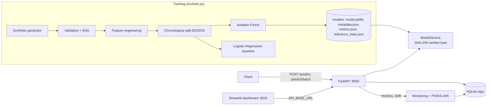

# Real-Time Fraud Detection API

Machine Learning + FastAPI + Docker + Render + Monitoring Dashboard

> **Educational portfolio project. All data is SYNTHETIC.** The anomaly scores are *not* fraud probabilities
> and this service must never be used to authorise, decline or investigate real payments.

## Overview

An end-to-end ML engineering project: a reproducible training pipeline (Isolation Forest + a supervised
Logistic Regression baseline), a validated REST API that scores transactions in real time, a Streamlit
monitoring dashboard, lightweight data-drift detection, automated tests, CI, Docker images, and a
Render free-tier deployment guide. Everything uses free, open-source tools and needs no paid services,
credit card, or secrets.

## Architecture



## Features

- Isolation Forest anomaly scoring with a **configurable** decision threshold (default chosen on the validation split).
- Supervised Logistic Regression baseline and honest side-by-side metrics.
- Data validation (schema, missing values, ranges, duplicate IDs, label checks) and EDA.
- Leakage prevention: chronological split first, every fit on the training split only, threshold on validation only.
- FastAPI: `/`, `/health`, `/model-info`, `/predict`, `/predict/batch`, `/metrics`, `/drift` (+ `/predictions/recent`, `/demo/generate`).
- Strict Pydantic validation (rejects missing, out-of-range, NaN/Infinity, unknown and malformed input) without echoing submitted values.
- Request IDs, JSON structured logs, no stack traces sent to clients.
- SQLite request/prediction log, latency percentiles (only with enough observations).
- PSI + KS drift monitor with a documented minimum sample size.
- AEGIS Cyber-FinTech Streamlit dashboard (Plotly) with attack scenario presets, real-time risk gauge, Explainable AI (XAI) feature attribution, forensic audit dossiers, PSI/KS drift sentinel, dual-model benchmarking, and latency SLA tracking.
- Pytest suite, GitHub Actions CI, manual/scheduled retraining workflow with a quality gate.
- Non-root Docker images with health checks and a one-command `docker compose up`.

## Technology stack

Python 3.11 · pandas · NumPy · scikit-learn · SciPy · FastAPI · Pydantic v2 · Uvicorn · Streamlit · Plotly ·
SQLite · Docker / Compose · pytest + HTTPX · GitHub Actions · Render.
Drift monitoring is a small custom PSI/KS implementation instead of Evidently, to keep installs light and
avoid version conflicts on free tiers.

## Dataset

By default the project generates a **synthetic** dataset (`src/data_generator.py`): 40,000 transactions over
60 days with 0.5% fraud (200 rows), including "subtle" fraud that overlaps normal behaviour. Nothing needs to
be downloaded and nothing sensitive is stored. See [`data/README.md`](data/README.md) for the CSV schema,
using your own labelled data, and notes on the Kaggle Credit Card Fraud dataset (ODbL licence, free account
required, **never committed here**).

## Anomaly score vs. probability of fraud

Isolation Forest is unsupervised. Its output (`anomaly_score = -score_samples`, higher = more unusual) ranks
how easy a point is to isolate from the training data. It is **not** P(fraud): it ignores labels, its scale
depends on the training data and hyperparameters, and "0.7" does not mean "70% likely fraud". Turning scores
into probabilities requires labelled data plus calibration (Platt scaling or isotonic regression) and
re-checking calibration over time. The API therefore returns `anomaly_score` and a thresholded classification only.

## Results (generated by `python -m src.train`)

Run in the author's sandbox (Python 3.12, scikit-learn 1.8, seed 42). Your numbers may differ slightly with the
pinned versions in `requirements.txt` - re-run training and use your own output. Test split = last 20% in time:
8,000 transactions, 37 fraud. Thresholds were chosen on the validation split only. **Synthetic data, so these
numbers say nothing about real-world performance.**

| Model (test split) | Precision | Recall | F1 | PR-AUC | ROC-AUC | TN / FP / FN / TP |
|---|---|---|---|---|---|---|
| Isolation Forest (unsupervised) | 0.828 | 0.649 | 0.727 | 0.763 | 0.982 | 7958 / 5 / 13 / 24 |
| Logistic Regression (supervised baseline) | 0.879 | 0.784 | 0.829 | 0.875 | 0.996 | 7959 / 4 / 8 / 29 |

- A model that flags **nothing** scores 99.54% accuracy on the same test split; Isolation Forest scores 99.78%.
  Accuracy alone says almost nothing under 0.5% prevalence - judge by PR-AUC, precision and recall.
- The supervised baseline beats Isolation Forest here because labels are available. Isolation Forest's value
  is that it needs no labels, which matters when labels are scarce or delayed.
- With only 37 fraud rows in the test set, the metrics are noisy (a handful of transactions moves recall by several points).
- Re-evaluating the saved model on fresh synthetic data (`python -m src.evaluate`, seed 123, 20,000 rows, 100 fraud):
  precision 0.831, recall 0.740, F1 0.783, PR-AUC 0.792.

## Installation (local)

```bash
git clone <your-repo-url> fraud-detection-api && cd fraud-detection-api
python -m venv .venv
source .venv/bin/activate            # Windows PowerShell: .venv\Scripts\Activate.ps1
pip install -r requirements-dev.txt
pip install -r requirements-dashboard.txt
python -m src.train                  # creates ./models/*
uvicorn app.main:create_app --factory --reload --port 8000
# second terminal (activate the venv again):
streamlit run dashboard/streamlit_app.py
```

Open http://localhost:8000/docs (Swagger UI) and http://localhost:8501 (dashboard).
Run the tests with `pytest -v`. The full 12-stage walkthrough is in [`docs/BUILD_GUIDE.md`](docs/BUILD_GUIDE.md).

## API examples

`POST /predict`

```bash
curl -X POST http://localhost:8000/predict -H "Content-Type: application/json" -d '{
  "transaction_id": "demo-0001", "amount": 245.5, "hour": 2, "merchant_category": 8,
  "distance_from_home_km": 320.0, "txn_count_24h": 7, "avg_amount_30d": 38.2,
  "is_online": 1, "is_foreign": 1, "card_age_days": 20, "is_synthetic": true }'
```

Response shape (values vary with your trained model):

```json
{
  "transaction_id": "demo-0001",
  "anomaly_score": 0.7123,
  "classification": "suspicious",
  "is_suspicious": true,
  "threshold": 0.6607,
  "model_version": "1.0.0-<sha8>",
  "processing_time_ms": 4.2,
  "request_id": "9f1c2e..."
}
```

`POST /predict/batch` takes `{"transactions": [ {...}, {...} ]}` (1-1000 items) and returns `predictions`,
`count`, `suspicious_count`, `threshold`, `model_version`, `processing_time_ms`, `request_id`.

Invalid input returns HTTP 422 without echoing submitted values:

```json
{"detail": "Request validation failed",
 "errors": [{"field": "hour", "message": "Input should be less than or equal to 23", "type": "less_than_equal"}],
 "request_id": "..."}
```

Other endpoints: `GET /health` (503 if the model cannot be loaded), `GET /model-info`, `GET /metrics`,
`GET /drift`, `GET /predictions/recent?limit=200`, `POST /demo/generate {"n": 50, "drift": false}`.


## Docker

```bash
docker compose up --build        # API on :8000, dashboard on :8501
docker compose down
```

The API image trains the model at build time from the synthetic generator, runs as a non-root user and has a health check.

## GitHub Actions

- `ci.yml` - on every push and pull request: install, train with a PR-AUC quality gate, run pytest, upload artifacts, build both Docker images.
- `retrain.yml` - manual (`workflow_dispatch`) or weekly, only when the repo variable `ENABLE_SCHEDULED_RETRAIN` is `true`.
  It optionally validates a labelled CSV you commit, trains a *candidate* model, runs tests and uploads it as an artifact.
  It never trains on unverified API traffic, and needs no secrets. See [`models/README.md`](models/README.md) for promotion steps.

## Deployment

Step-by-step Render free-tier guide: [`docs/DEPLOYMENT.md`](docs/DEPLOYMENT.md).

- Live API: https://fraud-detection-api-backend.onrender.com
- Live dashboard: https://fraud-detection-api-dashboard.onrender.com

Fill these in only after you have verified the live endpoints (checklist in `docs/PORTFOLIO.md`).

## Limitations and ethical considerations

- Synthetic data only; no evidence of real-world accuracy. Real fraud is adversarial and changes over time.
- Not a payment authorisation system: no authentication, rate limiting, audit trail, or human review workflow.
- Rate limiting is intentionally omitted: in-memory limiters reset on restart and misbehave with several workers, and reliable shared limiting needs extra infrastructure.
- SQLite logs live on ephemeral storage on Render's free tier and disappear on restart/redeploy. Free services also sleep when idle (cold start of roughly a minute).
- Drift monitoring watches input distributions only. A drift warning is not proof of fraud or model failure, and
  unchanged inputs do not prove the model is still good.
- Fraud models can discriminate (e.g. by geography or merchant type) and false positives cost real people access to
  their money. A real system needs fairness analysis, explanations, appeals and human oversight.
- Never put real cardholder data into this demo or its logs.

## Future improvements

Probability calibration with labelled data; threshold selection by cost of false positives vs. missed fraud;
API-key authentication and shared rate limiting; Postgres for durable logs; scheduled drift reports; model registry
and shadow deployment; feedback labels from analysts; SHAP-style explanations; load testing.

## License

MIT - see (LICENSE) Ayyappan M
